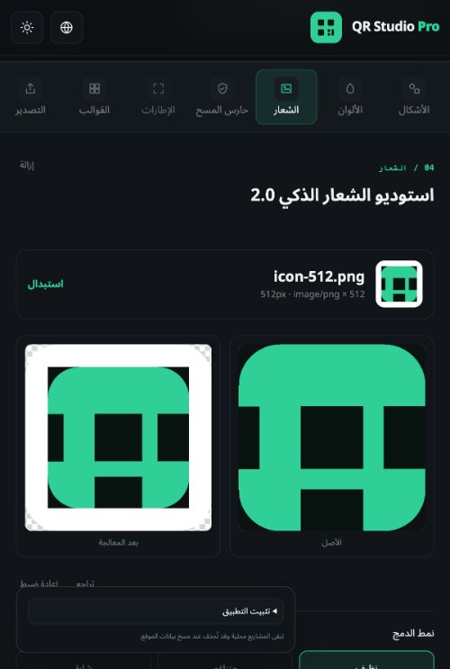
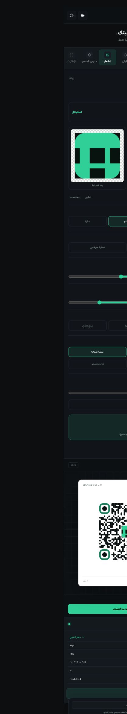
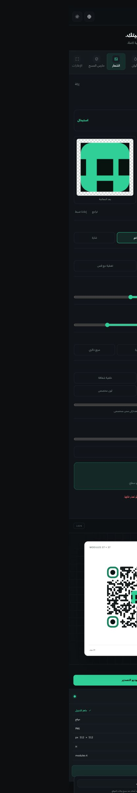

# QR Studio Pro

Professional, open-source QR code designer focused on privacy and a clean editing experience.

[](https://github.com/msqaisfx/qr-studio-pro/actions/workflows/quality.yml)
[](LICENSE)
[](https://github.com/msqaisfx/qr-studio-pro/releases)
[](https://msqaisfx.github.io/qr-studio-pro/)

> Public Beta — target version 0.9.1-beta.1

[Live app](https://msqaisfx.github.io/qr-studio-pro/) · [Repository](https://github.com/msqaisfx/qr-studio-pro) · [Report an issue](https://github.com/msqaisfx/qr-studio-pro/issues)



Arabic documentation: [README.ar.md](README.ar.md)

## Smart Logo Studio 2.0

- Separate controls for the QR logo container, visible artwork, and padding
- Aspect-ratio-safe **Contain** and previewable **Cover** rendering—never stretch
- Local transparent-padding trim and edge-connected solid-background removal
- Clean, Seamless, and Badge styles with custom shape, radius, color, and opacity
- Original/processed comparison, undo/reset, resolution guidance, and decode feedback
- Versioned project migration that keeps existing embedded logos intact

## Features

- Real QR generation for URLs, Arabic text, and English text
- Instant preview and validated PNG, SVG, WebP, JPEG, and PDF export
- Arabic (default, RTL) and English (LTR)
- Dark and light themes
- Professional responsive studio shell with tools, canvas, and inspector
- Six QR body patterns, supported corner styles, export sizing, and L/M/Q/H correction
- Calculated four-module quiet zones and verified UTF-8 QR payloads
- Independent solid or gradient colors for QR modules and corners, plus solid or transparent backgrounds
- Nine live color presets and an advisory multi-stop contrast guard
- Local PNG/JPEG/WebP logo processing with trimming, background removal, safe scaling, integration styles, and an independent decode guard
- Eleven locally encoded QR content types: website, text, Wi-Fi, vCard, WhatsApp, email, phone, SMS, location, event, and crypto
- A unified export studio with safe filenames, 256–4096 px raster output, SVG, quality controls, transparency, and print-page settings
- A local Scan Guard with independent payload decoding, measured quiet-zone and density checks, contrast, logo, finder-pattern, and export-format analysis
- Honest PASS, WARNING, FAIL, and UNKNOWN states with advisory recommendations and export blocking for unsafe or unverifiable results
- Versioned local IndexedDB projects with CRUD, search, recent sorting, optional autosave, and portable validated JSON files
- Twelve real, editable professional templates that preserve the current QR content and logo
- Installable PWA with subpath-safe metadata, original icons, offline app shell, and user-controlled updates
- Fully local offline generation, design, Scan Guard, project storage, and PNG/SVG/WebP/JPEG/PDF export after the first load
- Lazy-loaded studio tools that reduce the initial JavaScript bundle
- Locally bundled Inter and Noto Sans Arabic variable fonts
- Local-first: input is processed only in the browser
- TypeScript, linting, unit tests, and production build checks

## Local development

Requirements: Node.js 24 LTS and pnpm 11.25.0.

```bash
pnpm install --frozen-lockfile
pnpm dev
```

Then open the URL printed by Vite. Other checks:

```bash
pnpm typecheck
pnpm lint
pnpm test
pnpm build
# With the dev server running:
pnpm verify:phase04
pnpm verify:phase05
pnpm verify:phase06
pnpm verify:phase07
pnpm verify:phase08
pnpm verify:phase09
pnpm verify:phase10
pnpm verify:phase11
```

## Screenshots

| Smart Logo Studio | Seamless style | Background removal |
| --- | --- | --- |
|  |  |  |

## PWA and privacy

Install from the browser menu after opening the [live app](https://msqaisfx.github.io/qr-studio-pro/). Once cached, the studio, local projects, QR generation, Scan Guard, and exports work offline. QR payloads, project data, and uploaded logos stay in the browser; there is no analytics or tracking. Clearing site data removes local IndexedDB projects, and projects do not automatically move between domains.

## Roadmap and known limitations

The beta roadmap and completed phases are tracked in [docs/PHASES.md](docs/PHASES.md). Automated decoding is evidence, not a guarantee for every camera, print surface, or lighting condition. Complex photographic logo backgrounds require a dedicated editor; the built-in remover intentionally handles only edge-connected, near-solid backgrounds.

## Scope

This version intentionally has no backend, server database, accounts, analytics, payments, dynamic QR codes, or frames. See [docs/PHASES.md](docs/PHASES.md), [docs/PWA_AND_OFFLINE.md](docs/PWA_AND_OFFLINE.md), [docs/LOCAL_PROJECTS.md](docs/LOCAL_PROJECTS.md), and [docs/SCAN_GUARD.md](docs/SCAN_GUARD.md).

## Contributing and security

See [CONTRIBUTING.md](CONTRIBUTING.md), [CODE_OF_CONDUCT.md](CODE_OF_CONDUCT.md), [SECURITY.md](SECURITY.md), [PRIVACY.md](PRIVACY.md), [CHANGELOG.md](CHANGELOG.md), [THIRD_PARTY_LICENSES.md](THIRD_PARTY_LICENSES.md), and [RELEASE_CHECKLIST.md](RELEASE_CHECKLIST.md). Repository and hosting preparation are documented in [GITHUB_SETUP.md](GITHUB_SETUP.md), [DEPLOYMENT.md](DEPLOYMENT.md), and [CUSTOM_DOMAIN.md](CUSTOM_DOMAIN.md).

## License

MIT © 2026 Mohammed Qais Abdulghani. See [LICENSE](LICENSE).
